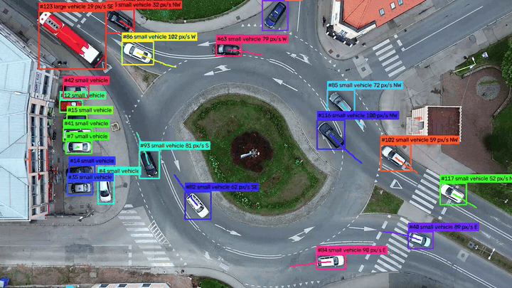
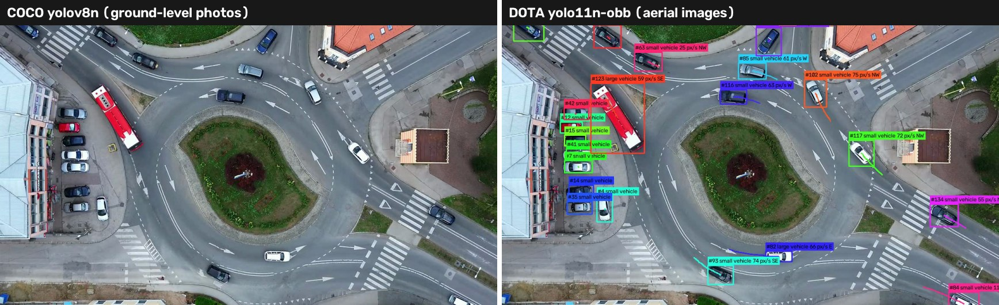
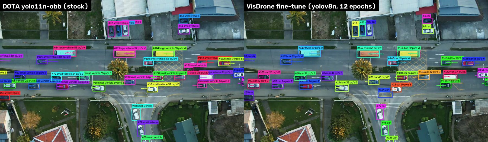

# Target Tracking AI

Real-time multi-object detection and tracking for drone-style aerial video.
A **YOLO** detector finds objects in each frame. A **from-scratch tracker** links them across frames so every object keeps a stable ID. The tracker uses a Kalman filter, Hungarian matching and ByteTrack-style two-stage association. Each object's speed and heading come from the filter's velocity.



*Each box shows the track ID, the class, and the speed and heading of moving vehicles. Parked cars get no speed, because their estimated motion stays under the 3 px/s noise threshold.*

## How it works

```
frame ─► YOLO ─► boxes, scores, classes
                       │
  1. predict  Kalman filter moves every track one frame ahead
  2. stage 1  tracks ↔ confident detections (score ≥ 0.5): IoU cost, Hungarian
  3. stage 2  unmatched confirmed tracks ↔ weak detections (0.1–0.5)
  4. misses   unmatched tracks age; tentative ones die, confirmed ones after max_age
  5. births   confident detections no track explains start tentative tracks
                       │
          tracks with IDs ─► speed / heading ─► annotated video + CSV log
```

| Module | What it does |
|---|---|
| `tracker/kalman.py` | 8-state constant-velocity Kalman filter (`cx, cy, w, h` + velocities), noise scaled by box size |
| `tracker/association.py` | IoU matrix, Hungarian assignment (`scipy.optimize.linear_sum_assignment`), IoU gating |
| `tracker/track.py` | Track life cycle (tentative → confirmed → deleted), class majority vote, trail |
| `tracker/tracker.py` | The per-frame loop above |
| `tracker/motion.py` | Speed (px/s, or km/h with a ground sample distance) and heading from the Kalman velocity |
| `tracker/detector.py` | Ultralytics YOLO wrapper for ordinary and oriented-box (OBB) models; class filter; low confidence for stage 2 |
| `tracker/pipeline.py` | Video file or camera → annotated `mp4` + `tracks.csv`, with per-stage timing |

## Quick start

```bash
python3.11 -m venv .venv && source .venv/bin/activate
pip install -r requirements.txt
python run_tracker.py --source path/to/drone.mp4                         # aerial model, writes outputs/run/
python run_tracker.py --source path/to/drone.mp4 --weights yolov8n.pt    # COCO model, for comparison
python run_tracker.py --source path/to/drone.mp4 --mpp 0.05              # 5 cm/pixel → speeds in km/h
python run_tracker.py --source 0 --max-frames 300                        # webcam
pytest -q
```

Ultralytics downloads the weights on first use. To use your own VisDrone fine-tune instead, see [Fine-tuning on VisDrone](#fine-tuning-on-visdrone).

`tracks.csv` has one row per track per frame: `frame, track_id, class, score, x1, y1, x2, y2, speed_px_s, speed_kmh, heading_deg, compass`.

## Tests

The tracker is tested without a model on synthetic data. The tests cover:

- learning velocity from noisy boxes
- coasting through missed frames
- Hungarian vs. greedy matching
- two crossing objects keeping their IDs
- recovery after a 6-frame occlusion
- low-score detections keeping a track alive without starting new ones
- an end-to-end run on a synthetic video

## Results on real drone footage

The tests used two free 1080p drone clips from Pexels:
- a roundabout where the drone climbs for 18 s, then hovers
- a busy street filmed from a static high-altitude drone

The hardware was an Apple M2 (MPS) with `imgsz=960`. FPS is measured end to end, after a 10-frame warm-up.



| | Roundabout, COCO `yolov8n` | Roundabout, DOTA `yolo11n-obb` | Street, COCO `yolov8n` | Street, DOTA `yolo11n-obb` |
|---|---|---|---|---|
| Tracked vehicles per frame (mean) | 1.3 | **34.1** | 0 | **52.4** |
| Track IDs over the clip | 9 | 79 | 0 | 119 |
| Median track length | 135 frames | 324 frames | – | 577 frames |
| End-to-end FPS | 17.3 | ~16 | 19.7 | 17.3 |
| Detector, median per frame | 34.5 ms | 35.8 ms | 36.8 ms | 37.6 ms |
| Tracker, median per frame | 0.25 ms | 1.8 ms | 0.04 ms | 2.5 ms |

What the numbers show:
- **The detector decides everything.** The COCO model is trained mostly on ground-level photos. It found almost none of the cars seen from above, and from high altitude it labelled cars as "potted plant", "banana" or "cell phone". Ultralytics' DOTA model is trained on aerial images. Swapping it in took tracking from about 1 vehicle per frame to 34–52, at the same speed.
- **The tracker is cheap.** Even with ~50 objects it takes 2–3 ms per frame, 5–7% of the detector's time. The rest of the frame time goes to video decoding, drawing and encoding.
- **Tracks are long-lived.** Median track length is 11–19 s, and almost no tracks are shorter than 15 frames. These clips have no ground-truth labels, so ID switches are not measured yet. That needs a labelled sequence such as VisDrone-MOT and MOTA/IDF1 metrics.
- **Speeds look plausible on the static clip.** Parked cars measure 0.3–0.5 px/s, which is the filter's noise floor. Moving cars mostly measure 30–75 px/s.

## Fine-tuning on VisDrone

DOTA's classes only say how big a vehicle looks ("small" or "large"), and DOTA has no people. [VisDrone2019-DET](https://github.com/VisDrone/VisDrone-Dataset) is a drone dataset with 10 classes: pedestrian, people, bicycle, car, van, truck, tricycle, awning-tricycle, bus and motor. So I fine-tuned a detector on it:

```bash
# put VisDrone2019-DET-train.zip and VisDrone2019-DET-val.zip in data/VisDrone/zips/
python training/prepare_visdrone.py --zips data/VisDrone/zips --out data/VisDrone   # unzip + convert labels to YOLO format
python training/train_visdrone.py --epochs 12 --imgsz 640 --batch 8 --workers 2 --close-mosaic 2
python run_tracker.py --source drone.mp4 --weights outputs/train/visdrone/weights/best.pt
```

**Setup:**
- Training data: 6,471 images with 343,204 objects. Validation: 548 images with 38,759 objects.
- Starting point: the COCO `yolov8n.pt`, so the comparison with the stock COCO model is fair (same network, different data).
- Settings: `imgsz=640`, 12 epochs, mosaic augmentation off for the last 2 epochs.
- Hardware: the same 8 GB Apple M2. Training took 4 h 36 min.

**Validation results** (VisDrone val, 548 images):
- mAP50: **0.264**. mAP50-95: **0.145**. Precision 0.387, recall 0.291.
- mAP50 per class: car 0.689, bus 0.354, van 0.305, pedestrian 0.270, motor 0.264, truck 0.236, people 0.208, tricycle 0.182, awning-tricycle 0.087, bicycle 0.048.
- mAP50 was still rising at the last epoch (0.152 after epoch 1, 0.264 after epoch 12). Longer training and a larger `imgsz` are the obvious next steps.
- Cars are by far the best class. Small, thin objects such as bicycles are where a nano model at 640 px struggles most.

**On the demo clips, against DOTA.** Only vehicle classes are counted: car, van, truck and bus vs. small and large vehicle.



| | Roundabout, DOTA | Roundabout, VisDrone | Street, DOTA | Street, VisDrone |
|---|---|---|---|---|
| Tracked vehicles per frame (mean) | 34.1 | 37.3 | 52.4 | 60.2 |
| Vehicle track IDs | 79 | 96 | 119 | 170 |
| Median track length | 324 frames | 282 frames | 577 frames | 461 frames |
| Likely ID switches (heuristic, see below) | 2 | 2 | 13 | 16 |
| Vehicle boxes with score < 0.5 | 10% | 11% | 7% | 22% |
| End-to-end FPS | ~16 | 20.6 | 17.3 | 20.8 |
| Detector, median per frame | 35.8 ms | 24.7 ms | 37.6 ms | 26.6 ms |

A "likely ID switch" means a vehicle track ends and, within 60 frames, a new track starts within 60 px of where the old one was heading. It is only a hint. Real MOTA/IDF1 needs labelled ground truth.

I also checked by eye every long track (≥ 100 frames) that one model has and the other doesn't:

| | VisDrone only (12 tracks) | DOTA only (6 tracks) |
|---|---|---|
| Real vehicles the other model missed | 4: cars half under trees or cut off by the image edge | 3: two cars and a scooter |
| Partial boxes | 3: the front of a bus, a truck's cab, a trailer, each tracked as its own object | – |
| False positives that never move | 4: a road-island marking as "van", rooftop structures as "bus", "van" and "car" | 3 tracks, 2 objects: a grave in a cemetery; an object on the median, tracked twice |
| Unclear | 1 | – |

What this shows:
- **VisDrone sees more and says what it sees.** It finds 9–15% more vehicles per frame and names their types. It also finds people, which DOTA can't. On the roundabout clip it tracked a walking person, but it labelled two groups of pedestrians as "motor", and one "pedestrian" was a dark object on the pavement.
- **It is less sure of itself on this footage.** On the street clip, 22% of its vehicle boxes score below 0.5, against 7% for DOTA. It also invents more static objects. Static false positives get a speed of ~0 px/s, so they don't fake motion, but they do inflate counts.
- **Tracking quality looks similar, not proven equal.** The ID-switch heuristic is close: 13 vs. 16 on the street. VisDrone has more track IDs and shorter median tracks, partly because it finds more objects. Without ground truth I can't tell how much of the rest is fragmentation.
- **It is faster.** On this Mac the detector takes 25–27 ms per frame instead of 36–38 ms, about 21 FPS instead of 16–17.

**Default weights stay DOTA.** Ultralytics downloads the DOTA model automatically. VisDrone is for academic, non-commercial use, so this repository ships the training scripts, not the dataset or the trained weights. Use the VisDrone model when you need vehicle types or people.

Training notes:
- On this Mac, training crashed once mid-epoch with a segmentation fault inside OpenCV 5.0's JPEG decoder. All 7,019 images decoded fine one by one, so no file was bad. The training script now decodes images with Pillow (`--decoder pillow`, the default) and can continue a run with `--resume`.
- VisDrone validation images hold up to 317 objects. The default `max_det=300` caps recall, and in a standalone `val()` it lowered mAP50 from 0.264 to 0.253. The script now validates with `max_det=1000`.

## Limitations

- **Camera motion:** speeds are relative to the image. While the drone climbs at the start of the roundabout clip, the scene zooms out. Parked cars near the edge then appear to move 35–50 px/s toward the centre. Ego-motion compensation (frame-to-frame homography) is not implemented yet.
- **Heading:** "N" means the top of the image, not geographic north.
- **DOTA classes:** "small vehicle" and "large vehicle" are about size in the image, not vehicle type, and DOTA has no person class. The [VisDrone fine-tune](#fine-tuning-on-visdrone) adds types and people, but with lower confidence and some static false positives.
- **Rotated boxes:** the OBB model's rotated box is turned into the axis-aligned box around it, because the Kalman state is `(cx, cy, w, h)`. For cars driving diagonally that box is looser, which makes IoU matching between neighbours less precise.
- **Long occlusions:** objects hidden for more than `max_age` frames (default 30) come back with a new ID. There are no appearance (re-ID) features.

## Credits and licences

- **Code:** MIT (see `LICENSE`).
- **Detector and weights:** [Ultralytics](https://github.com/ultralytics/ultralytics), AGPL-3.0.
- **Fine-tuning data:** [VisDrone2019-DET](https://github.com/VisDrone/VisDrone-Dataset) by the AISKYEYE team, Tianjin University. It is used for training only. Neither the dataset nor the trained weights are included.
- **Demo footage:** from [Pexels](https://www.pexels.com/license/):
  - [roundabout in Tuzla](https://www.pexels.com/video/aerial-view-of-busy-city-roundabout-in-tuzla-33269758/) by Aldin
  - [urban intersection](https://www.pexels.com/video/aerial-view-of-bustling-urban-traffic-intersection-33585547/) by badkz777

  The clips themselves are not included in this repository.
